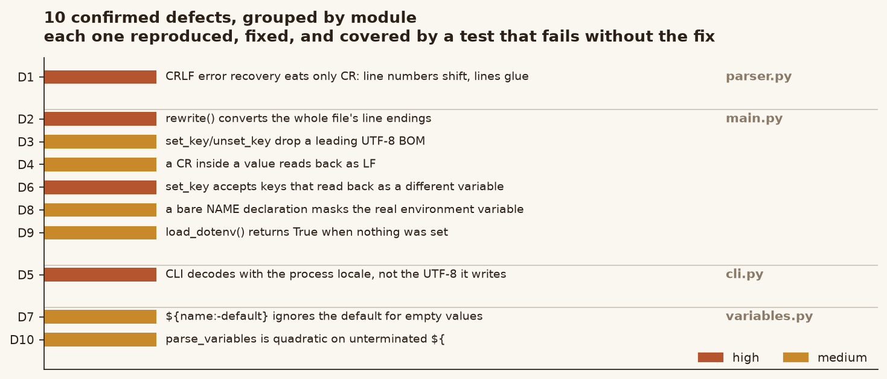
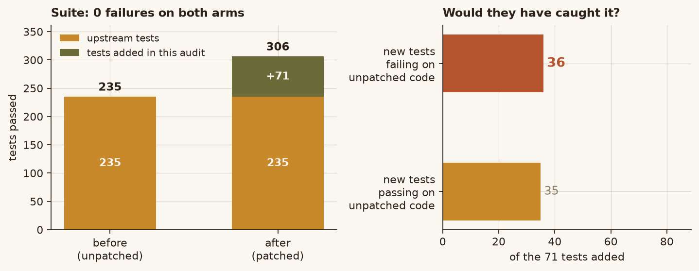

# python-dotenv — defect audit and fixes

A defect audit of [theskumar/python-dotenv](https://github.com/theskumar/python-dotenv)
at commit `0b28805` (v1.2.4), with fixes, regression tests, and the evidence that
the tests actually detect what they claim to.

This repository is a **working copy of upstream with fixes applied**, so it can be
cloned and tested directly. `audit/` holds the report, the patch, and the scripts
that produced every number below.

**Ten defects confirmed.** Each one was reproduced against the unpatched code,
fixed, covered by a test that fails without the fix, and re-checked by reverting
the fix (mutation testing).

---

## The defects



| id | module | severity | what goes wrong |
|----|--------|----------|-----------------|
| D1 | `parser.py` | high | On a CRLF file, error recovery consumes only the `\r` of `\r\n`. Reported line numbers shift by one, and because `set_key`/`unset_key` echo the parsed text back out, deleting a statement also deletes the next line's newline and glues two lines together. |
| D2 | `main.py` | high | `rewrite()` opens both the source and the temporary file with the default `newline=None`, so universal-newline translation rewrites every line ending in the file. One `dotenv set` on Windows converts a pure-LF file to CRLF in its entirety. |
| D3 | `main.py` | medium | The parser strips a leading UTF-8 BOM, so the BOM never reaches the text that gets written back. `set_key` and `unset_key` silently drop it. |
| D4 | `main.py` | medium | The read path has the same `newline=None` problem: a carriage return inside a value is flattened to `\n`, so the round-trip `set_key` promises does not hold. |
| D5 | `cli.py` | high | `set_key` writes UTF-8, but `stream_file()` opens with the process locale. On a Chinese Windows console that is GBK, so `dotenv get` prints mojibake, and characters the locale cannot represent raise `UnicodeDecodeError` as a traceback. |
| D6 | `main.py` | medium | `set_key` validates `quote_mode` but never validates the key. `set_key(path, "a=b", "x")` writes `a=b='x'` and returns success; reading the file back gives key `a` with value `b='x'`. |
| D7 | `variables.py` | medium | `${name:-default}` uses the default only when the key is *absent*. A key present with an empty value returns the empty string, which is not POSIX `:-` semantics. |
| D8 | `main.py` | medium | A bare `NAME` declaration parses to `None` and is placed into the expansion mapping, where it hides a real environment variable of the same name. `${NAME}` then expands to `""`. |
| D9 | `main.py` | medium | `load_dotenv()` returns `True` for content holding only valueless declarations, although nothing was set. Its docstring says `True` means at least one variable was set. |
| D10 | `variables.py` | medium | `parse_variables` is quadratic on an unterminated expansion. A value made only of `${` costs 1.8 s at 16 KB and 7.7 s at 32 KB, which is reachable through `load_dotenv`. |

The full write-up — reproduction, root cause, and the exact fix for each — is in
[`audit/REPORT.md`](audit/REPORT.md). Runnable reproductions are in
[`audit/REPRODUCE.md`](audit/REPRODUCE.md).

---

## D10: the quadratic scan


The name group `[^}:]*` is greedy. For a value made of many `${` and no closing
`}`, the engine swallows the whole tail at every start position and then backtracks
one character at a time looking for the brace: O(n²).

Measured on the two arms, one process per (arm, size), three rounds, median of
three in-process repeats. Band is min–max across rounds.

| value length | before | after |
|---|---|---|
| 2,000 chars | 28.4 ms | 0.003 ms |
| 4,000 chars | 111.8 ms | 0.002 ms |
| 8,000 chars | 436.1 ms | 0.002 ms |
| 16,000 chars | 1,775.9 ms | 0.002 ms |

Four times the input cost **15.4×** the time before and **0.6×** after — the
before arm is quadratic, the after arm is linear.

The fix replaces the regex with an equivalent linear scan. It is *equivalent*, not
merely faster: tightening the character class to `[^}:$]*` also fixed the timing,
but changed the parse result for **293 of 60,032 corpus inputs** (`${a$b}` stopped
being a variable named `a$b`). The final implementation was diffed against the
original regex over **120,250 inputs** — random strings plus structured edge cases
— with **0 differences**.

---

## Tests



```
before (unpatched)   235 passed, 0 failed, 50 skipped
after  (patched)     306 passed, 0 failed, 50 skipped
```

71 tests added. 36 of them fail on the unpatched code — that is the evidence they
detect the defects rather than merely passing. The other 35 pin behaviour that
already worked (accepted keys, mixed line endings, empty values) so a future change
cannot break it silently.

The 50 skips are upstream's own POSIX-only tests (symlinks, FIFOs, `chmod`,
`tzset`), which do not run on Windows.

> One correction worth recording: earlier in this audit the suite showed 20
> failures on Windows, and I had written them off as environment limitations. They
> were not the package's fault, but they were not "unavoidable" either — they were
> caused by this sandbox not having the `dotenv` console script installed and not
> exporting `SYSTEMROOT`/`COMSPEC` for `subprocess`. After `pip install -e .` and a
> complete environment, both arms run clean. The numbers above are from that run.

---

## Mutation testing


Reverting each fix one at a time and running the suite: **17 of 17 mutations are
killed**. The bar length is the number of independent tests that fail, which
matters more than the binary killed/survived — a fix guarded by one test is weak
evidence.

One mutation *survived* during this work and is worth mentioning because it
falsified something I had written in a code comment: changing
`result is None or result == ""` to `if not result` makes no difference for
`str | None` inputs, since `not "0"` is `False`. That is an equivalent mutant, not
a coverage hole, and the comment has been corrected.

---

## What is in here

```
src/dotenv/            upstream sources with the ten fixes applied
tests/                 upstream tests + 71 added
audit/
  REPORT.md            full write-up: reproduction, root cause, fix, per defect
  REPRODUCE.md         runnable reproduction for each defect
  dotenv-fixes.patch   the diff, applies to upstream 0b28805 with `patch -p1`
  UPSTREAM_README.md   upstream's own README (this file replaces it)
  results_*.json       every number used in the report and the figures
  bench_perf.py        produces results_perf.json
  collect_facts.py     produces results_facts.json
  collect_mutations.py produces results_mutations.json
  make_charts.py       produces docs/figures/*.png from those json files
  evidence/            one script per probe, plus cross-platform byte checks
docs/figures/          the four figures above
```

Every figure is generated by `audit/make_charts.py` from a `results_*.json` that
came out of an actual run. No number in the report or the figures is hand-typed.

---

## Running it

```bash
pip install -e .
pytest tests -q                    # 306 passed, 50 skipped
```

Reproduce the figures:

```bash
python audit/bench_perf.py         # ~35 s
python audit/collect_facts.py
python audit/collect_mutations.py  # ~35 s
python audit/make_charts.py        # needs matplotlib
```

Cross-platform byte-level checks, for the line-ending and BOM fixes, without
needing a POSIX host:

```bash
python audit/evidence/cross_platform.py    # 19/19
```

---

## Scope and caveats

- **Baseline**: upstream commit `0b28805`, v1.2.4. Verified by exporting with
  `git archive HEAD`, normalising to LF, and comparing blob SHA-1 against
  `git rev-parse HEAD:<path>` for each modified file — 6/6 match.
- **Platform**: fixes were developed and tested on Windows 11 with CPython 3.13.14.
  The POSIX-only tests in the suite were not executed here; the line-ending, BOM,
  and encoding fixes are asserted at the byte level precisely because those tests
  cannot run.
- **Not fixed, deliberately**: a NUL byte in a value raises `ValueError` from
  `os.environ` and leaves earlier assignments applied. `os.environ` cannot hold a
  NUL, so raising is correct, and `load_dotenv` writes entries one by one rather
  than transactionally. Making it all-or-nothing would be an API change, not a bug
  fix. See `audit/REPORT.md` §4 for the other cases examined and rejected.
- **Upstream**: these fixes have not been submitted upstream. The patch is in
  `audit/dotenv-fixes.patch` if they are useful to anyone.

## License

Upstream is BSD-3-Clause; see [LICENSE](LICENSE). The audit material in `audit/`
is offered under the same terms.
