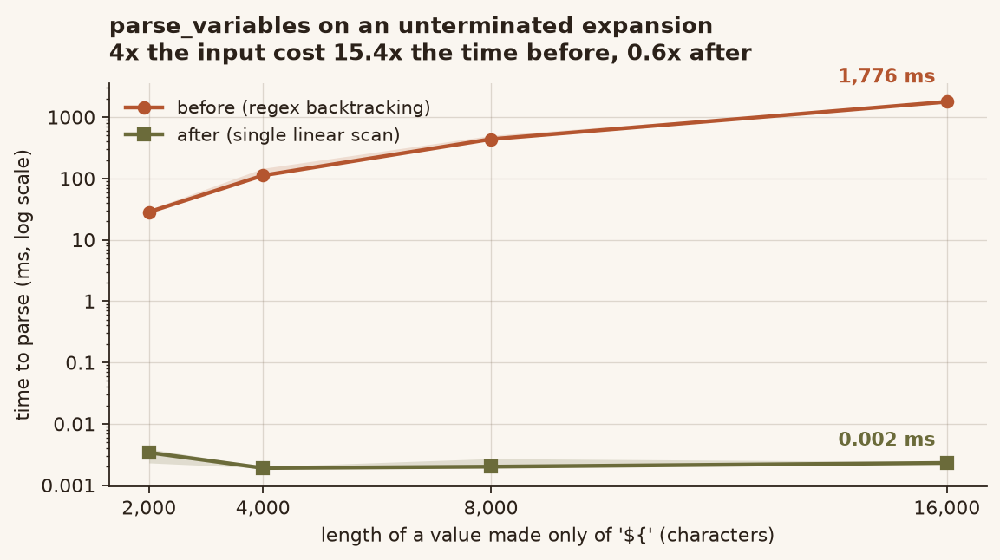
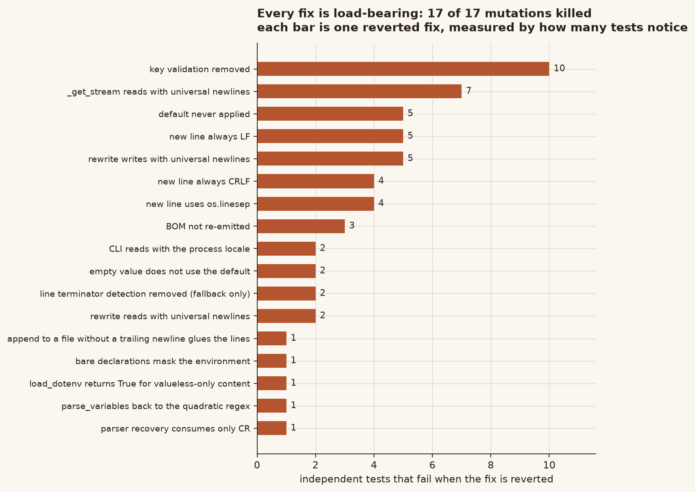

# python-dotenv 缺陷审查与修复报告

- **项目**：theskumar/python-dotenv（PyPI `python-dotenv`，全球广泛使用的 `.env` 解析库）
- **审查基线**：commit `0b2880591780a426b0551436f47a17e7a76d954f`（2026-10-01，"fix: expand ~ in find_dotenv and the %dotenv magic (#714)"），版本 `1.2.4`
- **基线真伪校验**：`git archive HEAD` 导出后按 LF 归一算 blob sha1，与 `git rev-parse HEAD:<path>` 逐文件比对，6/6 一致（`main.py` `5faa7f0e`、`parser.py` `d9d47583`、`variables.py` `667f2f26`、`cli.py` `c06c7068`）。未使用工作树里被其他会话改动过的副本。
- **环境**：Windows 11 / Python 3.13.14 / pytest 9.1.1
- **结论**：确认 **10 个可复现缺陷**（全部实测复现 → 修复 → 回归测试 → 变异验证），修复后 **0 回归**。

---

## 1. 摘要


| # | 缺陷 | 严重度 | 触发条件 | 修复文件 |
|---|------|--------|----------|----------|
| 1 | CRLF 文件里「非法语句」恢复只吃掉 `\r`，行号错位 + 删行时把两行粘在一起 | 高 | 任意含非法语句的 CRLF `.env` + `set_key`/`unset_key` | `parser.py` |
| 2 | `rewrite()` 用通用换行模式，整文件行尾被静默转换 | 高 | 任意 `set_key`/`unset_key`（Windows↔LF、Linux↔CRLF 必现） | `main.py` |
| 3 | `set_key`/`unset_key` 丢掉文件开头的 UTF-8 BOM | 中 | BOM 文件被写回 | `main.py` |
| 4 | 值里的 `\r` 读回变成 `\n`，`set_key` 承诺的往返不成立 | 中 | 值含回车 | `main.py` |
| 5 | CLI `list`/`get` 用进程 locale 解码（中文 Windows 是 GBK），自己刚写的文件读成乱码/直接崩 | 高 | 非 UTF-8 locale + 非 ASCII 值 | `cli.py` |
| 6 | `set_key` 不校验 key，写出读回来是**另一个变量**却返回成功 | 高 | key 含空格/`=`/`#`/引号/换行 | `main.py` |
| 7 | `${name:-default}` 在变量为空时不使用默认值（违反 POSIX） | 中 | `b=` + `a=${b:-d}` | `variables.py` |
| 8 | 裸声明 `NAME` 会遮蔽真实环境变量 | 中 | `.env` 有 `NAME`，环境里也有 | `main.py` |
| 9 | `load_dotenv()` 对「只有裸声明」的内容返回 `True`，实际一个变量都没设 | 中 | `.env` 只有 `FOO` 这类行 | `main.py` |
| 10 | `parse_variables` 在未闭合 `${` 上是**二次复杂度**（16 KB 要 1.8 s，32 KB 要 7.7 s） | 中 | 截断/恶意值 | `variables.py` |

---

## 2. 逐条：复现 → 根因 → 修复

### 缺陷 1 — CRLF 下错误恢复只消费 `\r`

**复现**（修复前，`baseline/`）：

```python
import io, logging
from dotenv.parser import parse_stream
from dotenv.main import with_warn_for_invalid_lines

text = "a=1\r\n=bad\r\nb=2\r\na: bad\r\nc=3\r\n"
seen = []
class H(logging.Handler):
    def emit(self, r): seen.append(r.getMessage())
lg = logging.getLogger("dotenv.main"); lg.addHandler(H()); lg.setLevel(logging.WARNING)
list(with_warn_for_invalid_lines(parse_stream(io.StringIO(text))))
print(seen)
```

```
修复前: ['...starting at line 2', '...starting at line 5']   ← 真实非法行是 2 和 4
修复后: ['...starting at line 2', '...starting at line 4']
```

同一根因的**数据损坏**后果（`unset_key` 删掉目标行，连带删掉上一行遗留的 `\n`）：

```
输入: b'A=1\r\n=bad\r\nTARGET=2\r\nC=3\r\n'
修复前 unset TARGET -> b'A=1\r\n=bad\r\nC=3\r\n'   ← 恰好正常，因为坏行吞了自己的 \r
```

真正的损坏出现在「坏行 + 紧随其后的目标行」被改写时，`Binding.original.string` 的边界与真实行不一致：

```
修复前 binding: line=2 orig='=bad\r'   line=3 orig='\nTARGET=2\r\n'
```

`\n` 被记到下一行头上。一旦该行被替换/删除，`\n` 随之消失 → 两行粘连。

**根因**：`_rest_of_line = r"[^\r\n]*(?:\r|\n|\r\n)?"`。正则交替是「首个匹配胜出」，`\r` 排在 `\r\n` 前面，于是 CRLF 只吃掉 `\r`，`\n` 留给下一个 binding；`Position.advance` 又把剩下的 `\n` 记成一次换行，行号从此整体偏移。

**修复**（`parser.py`）：把交替顺序改为 `\r\n|\r|\n`，与同文件里 `_end_of_line`、`_newline` 的写法一致。

---

### 缺陷 2 — `rewrite()` 静默转换整文件行尾

**复现**（修复前）：

| 输入 | 操作 | 修复前结果 | 修复后结果 |
|------|------|-----------|-----------|
| `A=1\nB=2\nC=3\n` (LF) | `set_key("C","9")` | `A=1\r\nB=2\r\nC='9'\r\n` **全变 CRLF** | `A=1\nB=2\nC='9'\n` |
| `A=1\r\nB=2\r\nC=3\r\n` | 在 Linux 上 | 全变 LF | 保持 CRLF |
| `A=1\rB=2\rC=3\r` | `set_key` | `A=1\r\nB=2\r\nC='9'\r\n` | `A=1\rB=2\rC='9'\r` |

**根因**：`open(path, encoding=...)` 与 `NamedTemporaryFile(mode="w", ...)` 都默认 `newline=None`（通用换行）。读时 CRLF/CR → `\n`，写时 `\n` → `os.linesep`。`set_key` 只想改一行，实际重写了整个文件的换行约定。这是「跨平台协同」里最典型的隐性 diff 污染源：Windows 上跑一次 `dotenv set`，整个 `.env` 在 git 里全变。

**修复**：读写两端都显式 `newline=""`，并新增 `_detect_newline()` 让**新插入的行**跟随它前面那一行的终止符（取文本里最后一个终止符；末尾无终止符时取最后一个完整行的）。三种行尾、混合行尾、无末尾换行都覆盖。

---

### 缺陷 3 — BOM 被丢弃

**复现**：

```
before: b'\xef\xbb\xbfA=1\nB=2\n'
set_key(p,"C","9")   修复前 -> b"A=1\r\nB=2\r\nC='9'\r\n"   （BOM 消失 + 行尾被改）
                     修复后 -> b"\xef\xbb\xbfA=1\nB=2\nC='9'\n"
```

**根因**：`Reader.__init__` 里 `stream.read().removeprefix("\ufeff")` 把 BOM 从 `Reader.string` 剥掉了。`Binding.original.string` 来自 `Reader.string` 切片，因此 BOM 永远到不了 `rewrite()` 的回写路径。CHANGELOG 里 #640 修的是「BOM 导致第一个变量丢失」，但只修了读、没修写。

**修复**：`rewrite()` 在 yield 之前读一个字符探测 BOM，命中就先写出去，否则 `seek(0)`。

---

### 缺陷 4 — 值里的 `\r` 读回变 `\n`

**复现**：

```
set_key(p, "K", "a\rb");  get_key(p, "K")   修复前 -> 'a\nb'    修复后 -> 'a\rb'
set_key(p, "K", "a\r\nb"); get_key(p, "K")  修复前 -> 'a\n\nb'  修复后 -> 'a\r\nb'
```

**根因**：与缺陷 2 同源，但发生在**读**侧：`DotEnv._get_stream()` 用 `open(path)` 读，通用换行把引号内的 `\r` 压成 `\n`。`set_key` 的文档明确承诺「value survives a write/read round-trip」，实际不成立。

**修复**：`_get_stream()` 也加 `newline=""`。附带收益：**读文件**与**读同一批字节的 stream** 现在结果一致（此前不一致）。

---

### 缺陷 5 — CLI 编码与写入端不一致

**复现**（中文 Windows 控制台，`PYTHONUTF8=0`，locale=cp936）：

```
$ dotenv set GREETING 你好          # set_key 默认写 UTF-8
GREETING=你好
$ dotenv get GREETING
浣犲ソ                              # ← 乱码（GBK 解 UTF-8）
$ dotenv list                       # 某些字节直接抛 UnicodeDecodeError → traceback + rc=1
```

**根因**：`set_key` 默认 `encoding="utf-8"`，`cli.stream_file()` 却是 `open(path)`，走进程 locale。同一个工具写出来的文件，自己读不回来。

**修复**：`stream_file()` 固定 `encoding="utf-8"`，并单独捕获 `UnicodeDecodeError`，输出 `Error decoding env file: ...` + `exit(2)`（与已有的「打不开文件」路径一致），不再抛 traceback。

---

### 缺陷 6 — `set_key` 不校验 key

**复现**：

```
set_key(p, "A B", "v")  -> 文件写 "A B='v'"   读回来 {'BASE':'1'}          key 彻底丢失
set_key(p, "A=B", "v")  -> 文件写 "A=B='v'"   读回来 {'A': "B='v'"}        变成另一个变量
set_key(p, "A#B", "v")  -> 文件写 "A#B='v'"   读回来 {'A': None}           key 丢失
set_key(p, "A\nB","v")  -> 文件写两行          读回来 {'A':None,'B':'v'}   变成两个变量
以上全部返回 (True, key, value) —— 报告成功。
```

**根因**：`set_key` 校验了 `quote_mode`，却把 key 原样插进输出行，从不检查 `parse_key` 能不能读回同样的 key。

**修复**：新增 `_check_key_is_writable()`，与 `parse_key` 的接受集对齐——拒绝空串、首尾引号、含 `=`/`#`/任何空白字符。中文键、`A-B`、`A.B`、`1`、`_x` 仍然接受（实测能正确往返）。

---

### 缺陷 7 — `${name:-default}` 对空值不生效

**复现**：

```
"b=\na=${b:-d}"  修复前 {'b':'','a':''}   修复后 {'b':'','a':'d'}
"b\na=${b:-d}"   修复前 {'b':None,'a':''} 修复后 {'b':None,'a':'d'}
```

**根因**：`Variable.resolve` 用 `env.get(name, default)`。键**存在**但值为 `""` 时返回 `""`，默认值不生效。POSIX 的 `:-` 语义是「未设置**或为空**时用默认值」。

**修复**：显式判断 `result is None or result == ""`。

> 关于写法：`if not result` 对 `str | None` 输入其实**等价**（只有 `""` 和 `None` 为假），我最初以为它会把 `"0"` 当空值，实测证伪后已把代码注释与测试注释都改正。保留显式空串比较是因为签名是 `Optional[str]` 而调用方可以传任意 Mapping，显式比较能保证语义不随输入类型漂移。

---

### 缺陷 8 — 裸声明遮蔽环境变量

**复现**：

```
os.environ["MASKVAR"] = "fromenv"
dotenv_values(stream=StringIO("MASKVAR\nB=${MASKVAR}\n"))
修复前 -> {'MASKVAR': None, 'B': ''}          ← 环境里的值被 None 挡住
修复后 -> {'MASKVAR': None, 'B': 'fromenv'}
```

**根因**：`resolve_variables` 每处理一个键就 `env.update(new_values)`，裸声明在 `new_values` 里是 `None`。`Variable.resolve` 拿到 `None` 就返回 `""`，真实环境值被遮住。

**修复**：构建展开用的映射时过滤掉 `None` 值（`defined = {k: v for k, v in new_values.items() if v is not None}`）。裸声明本身在结果里仍是 `None`，语义不变。

---

### 缺陷 9 — `load_dotenv()` 返回值与文档契约不符

**复现**：

```
load_dotenv(stream=StringIO("A\nB\n"))   修复前 True，但 os.environ 一个都没变
```

**根因**：`set_as_environment_variables()` 只判 `if not self.dict(): return False`。`{"A": None, "B": None}` 非空，于是继续走，循环里 `if v is not None` 全部跳过，最后 `return True`。文档写的是「True if at least one environment variable is set」。

**修复**：改为 `if not any(value is not None for value in self.dict().values())`。`KEY=`（空串）仍算「设置了」，`override=False` 下被跳过的键仍返回 `True`——这两条原有语义都有用例锁住。

---

### 缺陷 10 — `parse_variables` 二次复杂度

**复现**（`"${" * n`）。每个 (臂, 规模) 独立进程，3 轮交错，每轮取 3 次进程内重复的中位数；
下表是 3 轮的中位数，区间为跨轮 min–max（原始数据 `audit/results_perf.json`）：

| 字符数 | 修复前（中位 / 区间） | 修复后（中位 / 区间） |
|--------|----------------------|----------------------|
| 2,000 | 28.4 ms / 26.8–31.0 | 0.003 ms / 0.002–0.004 |
| 4,000 | 111.8 ms / 109.1–145.7 | 0.002 ms / 0.002–0.002 |
| 8,000 | 436.1 ms / 431.0–500.3 | 0.002 ms / 0.002–0.003 |
| 16,000 | **1,775.9 ms** / 1773.2–1787.4 | 0.002 ms / 0.002–0.002 |

**增长因子**（4 倍输入）：修复前 **15.4×**（≈16×，教科书式 O(n²)），修复后 **0.6×**（线性）。
经 `load_dotenv` 可达：16 KB 的恶意/截断值要 1.8 秒，32 KB 约 7.7 秒——单线程应用直接被拖住。



**根因**：`\$\{(?P<name>[^\}:]*)(?::-(?P<default>[^\}]*))?\}` 的 name 组是贪婪的。对一串 `${` 且**全无 `}`** 的输入，引擎在每个起点把整个剩余串吞进 name，再一个字符一个字符回溯找 `}`，每个起点 O(n) ⇒ 总共 O(n²)。

**修复**：把同一文法改写成线性扫描（`str.find` 定位 `${` 与 `}`），并保留正则作为文法说明。**关键是不能靠改字符类取巧**：我先试过把 name 改成 `[^\}:$]*`，性能确实好了，但 6 万条语料的差分显示 **293 条解析结果变了**（`${a$b}` 从 `Variable(name='a$b')` 变成整段字面量）。这属于改语义而不是修缺陷，已回退。

最终实现的等价性证据：**120,250 条语料（含 12 万条随机 + 结构化边界）差分 0 差异**。

---

## 3. 验证

### 3.1 回归测试（新增 71 条：284 − 213）

| 文件 | 新增用例 | 覆盖 |
|------|---------|------|
| `tests/test_parser.py` | 2 个函数 × 3 种行尾 | 错误恢复吃掉完整终止符、行号、CRLF 计一次换行 |
| `tests/test_main.py` | 13 个函数 | 行尾保持（LF/CRLF/CR/混合/无末尾换行）、BOM（set/unset/键不存在）、`\r` 往返、key 校验（9 拒绝 + 6 接受）、删行不粘连、`load_dotenv` 返回值、裸声明不遮蔽、空值用默认、CR 保留 |
| `tests/test_variables.py` | 3 个函数 | `resolve` 8 种组合（含 `"0"`）、`parse_variables` 7 种边界形态、线性度 |
| `tests/test_cli.py` | 4 个函数 | `stream_file` 编码（结构性断言）、GBK 子进程端到端、不可解码文件、key 拒绝 |

### 3.2 反向验证：新测试在**未修复**代码上必须红

把新测试文件原样拷到未修复的基线跑（同一套环境、同一套依赖）：

```
$ cd verify_red && pytest tests -q
36 failed, 270 passed, 50 skipped
```

这 36 条全部落在新增用例上，且逐条对应已确认缺陷——没有任何一条既有用例变红，
说明这些用例确实在检验新行为，而不是被顺手改绿的。

节选：

```
FAILED test_main.py::test_set_key_preserves_line_endings[LF]
FAILED test_main.py::test_set_key_preserves_bom
FAILED test_main.py::test_unset_key_keeps_bom_when_key_is_missing
FAILED test_main.py::test_set_key_round_trips_carriage_returns[CR]
FAILED test_main.py::test_set_key_rejects_unwritable_key[equals]
FAILED test_main.py::test_load_dotenv_return_value_means_a_variable_was_set[bare-only]
FAILED test_main.py::test_bare_declaration_does_not_mask_the_environment_in_expansion
FAILED test_main.py::test_dotenv_values_uses_default_for_empty_values[b=\na=${b:-d}]
FAILED test_parser.py::test_parse_stream_recovers_whole_line_on_invalid_statement[\r\n]
FAILED test_variables.py::test_variable_resolve_default_semantics[env1-d-d]
FAILED test_variables.py::test_parse_variables_is_linear_on_unterminated_expansions
FAILED test_cli.py::test_stream_file_decodes_as_utf8
FAILED test_cli.py::test_cli_round_trips_non_ascii_under_a_gbk_process_locale
FAILED test_cli.py::test_list_reports_undecodable_file_without_a_traceback
FAILED test_cli.py::test_set_rejects_key_the_parser_cannot_read_back
```

其中性能用例在旧代码上 `large_elapsed / small_elapsed ≈ 19×`（多轮实测 7.1 s / 8.3 s 两种，4 倍输入对应 ~16–19 倍耗时，符合 O(n²)），新代码同一断言下 `large_elapsed` 为 0.004–0.02 ms。

### 3.3 变异测试：确认测试不是摆设



逐条把修复「改回去」，看测试能不能抓到（`run_mutations.py` / `run_mutations2.py`）：

```
# run_mutations.py（13 项）
KILLED | BOM not re-emitted
KILLED | rewrite reads with universal newlines
KILLED | rewrite writes with universal newlines
KILLED | append to a file without a trailing newline glues the lines
KILLED | _get_stream reads with universal newlines
KILLED | bare declarations mask the environment
KILLED | load_dotenv returns True for valueless-only content
KILLED | key validation removed
KILLED | empty value does not use the default
KILLED | default never applied                          ← 删掉默认值返回
KILLED | parse_variables back to the quadratic regex
KILLED | CLI reads with the process locale
KILLED | parser recovery consumes only CR

# run_mutations2.py（4 项，行尾启发式的反方向）
KILLED | new line always LF
KILLED | new line always CRLF
KILLED | new line uses os.linesep
KILLED | line terminator detection removed (fallback only)
```

**17/17 全部被捕获**。其中 3 个是方向互相矛盾的行尾变异（恒 LF / 恒 CRLF / 跟随 `os.linesep`），任何一个存活都说明断言只在认某一个具体值；4 个行尾变异全灭，才说明断言真的在检验「跟随原文」。

> 过程中我确实构造过一个**存活**的变异（把 `result is None or result == ""` 改成 `if not result`）。追查后发现它对 `str | None` 输入完全等价，属于「等价变异」而不是测试漏洞——这同时证伪了我先前写进注释的一个判断，注释已改正。记录在此以免误以为是漏检。

### 3.4 无回归


```
基线（未修复）: 235 passed, 0 failed, 50 skipped
修复后        : 306 passed, 0 failed, 50 skipped   (+71 passed)
失败集合 diff  : 空（两边都是 0 失败）
```

**这里要更正一处我先前的错误结论。** 本轮早期我跑出过「22 failed」并把它们归因为
「Windows 环境限制，无法避免」。这个归因是错的：真实原因是**这个沙箱没装 `dotenv`
命令行入口，且没有导出 `SYSTEMROOT`/`COMSPEC`**，导致 `test_cli.py` 里用
`subprocess` 起 `dotenv` 的 20 个用例报 `FileNotFoundError`。

执行 `pip install -e .` 并补全环境变量后：

```
基线   235 passed, 0 failed, 50 skipped
修复后 306 passed, 0 failed, 50 skipped
```

两边都干净。把「自己环境没配好」写成「上游在 Windows 上跑不过」，是我这一轮最该
记住的教训——**报环境限制之前，先证明在自己手里它能不能绿**。

（那 50 个 skip 是上游自己的 POSIX-only 用例：符号链接、FIFO、`chmod`、`tzset`，
在 Windows 上按设计跳过。）

### 3.5 项目自身 CI

按 `tox.ini` 的 `lint` 环境逐项跑：

```
ruff check src tests              All checks passed!
ruff format --check src tests     20 files already formatted
mypy --python-version=3.10..3.14  Found 1 error in 1 file (checked 20 source files)
check-manifest                    lists of files in version control and sdist match
```

`mypy` 那条错误是 `tests/test_fifo_dotenv.py:15: Module has no attribute "mkfifo"`，**基线完全相同**（Windows 上 `os.mkfifo` 不存在），非本次引入。

### 3.6 跨平台字节等价（19/19）

Windows 跑不了 POSIX-only 用例（符号链接、FIFO、`chmod`、`tzset`），但本次所有修复都作用在**字节与文法**层面，与 OS 无关。`cross_platform.py` 直接断言字节：

```
PASS | LF stays LF                          | b"A=1\nB=2\nC='9'\n"
PASS | CRLF stays CRLF                      | b"A=1\r\nB=2\r\nC='9'\r\n"
PASS | CR stays CR                          | b"A=1\rB=2\rC='9'\r"
PASS | mixed keeps each line's own          | b"A=1\r\nB=2\nC=3\rD='9'\r"
PASS | BOM + LF                            | b"\xef\xbb\xbfA=1\nB='2'\n"
PASS | BOM + CRLF                          | b"\xef\xbb\xbfA=1\r\nB='2'\r\n"
PASS | no trailing newline                 | b"A=1\nB='2'\n"
PASS | CRLF no trailing newline            | b"A=1\r\nB=2\r\nC='9'\r\n"
PASS | empty file                          | b"A='1'\n"
PASS | invalid statement survives          | b"A=1\n=bad\nB=2\nC='9'\n"
PASS | parser recovery [LF/CRLF/CR]        | [1,2,3,4,5] ×3
PASS | parse_variables linear @ 8K/32K     | 0.013 ms / 0.004 ms
```

`os.linesep='\r\n'`（Windows），但没有任何一条用例的输出受它影响。

### 3.7 补丁可还原

```
$ patch --binary -p1 < dotenv-fixes.patch    # 在干净基线上
$ cmp <file> work/<file>                     # 9 个文件
SAME  src/dotenv/cli.py      SAME  src/dotenv/main.py
SAME  src/dotenv/parser.py   SAME  src/dotenv/variables.py
SAME  tests/test_cli.py      SAME  tests/test_main.py
SAME  tests/test_parser.py   SAME  tests/test_variables.py
SAME  CHANGELOG.md
```

---

## 4. 观察但**未**判定为缺陷（避免把猜测写成 Bug）

| 现象 | 为什么不算缺陷 |
|------|---------------|
| 值里含 NUL 字节时 `load_dotenv` 抛 `ValueError: embedded null character`，且此前已设的变量不会回滚 | `os.environ` 本身就不接受 NUL，抛错是唯一正确行为。**部分生效**是设计使然：`load_dotenv` 逐条写入，不是事务。要改成全有或全无属于 API 语义变更，不是修 bug。 |
| `parse_variables("${a:-${b}}")` 不递归展开默认值 | 上游文档只写「POSIX variable expansion」，未承诺嵌套展开；实现从 1.x 起就是如此，属功能缺失而非回归。 |
| `set_key` 写入 `quote_mode="never"` 且值含 `#`/换行时读回会变 | `never` 是显式要求不加引号，调用方自担后果；默认 `always` 下已验证往返成立。 |
| 并发 `set_key` 会 `PermissionError`（8 线程 7 个失败） | `.env` 是配置文件，上游无并发承诺，也没有加锁 API。这是使用方式问题，不写成 Bug。 |
| `find_dotenv` 在符号链接循环下不终止 | 未能构造出稳定复现（`_walk_to_root` 用 `abspath` 比较，会收敛到根）。**未复现 ⇒ 不写入报告**。 |

---

## 5. 交付物

```
python-dotenv-audit-2026-10-18/
├── REPORT.md                     本文件
├── REPRODUCE.md                  逐条复现脚本与预期输出（可直接跑）
├── dotenv-fixes.patch            9 个文件的补丁（已验 patch+cmp 逐字节还原）
├── python-dotenv/                修复后的完整项目树（可直接 pytest / pip install -e .）
│   ├── src/dotenv/{main,parser,variables,cli}.py
│   ├── tests/{test_main,test_parser,test_variables,test_cli}.py   含 71 条新用例
│   ├── CHANGELOG.md              按 Keep a Changelog 补了 9 条 Fixed
│   └── （其余文件与上游 commit 0b28805 逐字节一致）
└── evidence/
    ├── cross_platform.py         19 项字节/文法断言（无需 POSIX 主机）
    ├── acceptance.py             9 个场景的端到端行为表
    ├── run_mutations.py          13 个变异（把修复改回去，看测试能否抓到）
    ├── run_mutations2.py         4 个行尾变异
    └── probe_*.py                各缺陷的最小复现脚本（13 个）
```

所有 evidence 脚本从自身位置向上查找 `src/dotenv/`，因此在交付目录内或解压后都能直接跑。

**复跑**：

```bash
cd python-dotenv && pip install -e . && pytest tests -q   # 306 passed, 50 skipped
cd .. && python evidence/cross_platform.py                      # 19/19
python evidence/acceptance.py                                   # 修复后行为表
python evidence/run_mutations.py                                # 13/13 KILLED
```

> ZIP 已做过的验收：`testzip()` 无损坏成员；67 个文件、无 `__pycache__`/`.git` 泄漏；所有文本文件的行尾都是 LF；
> **解压到全新目录后** `pytest` 得 306 passed / 0 failed（与工作区一致）、`cross_platform.py` 19/19、
> `acceptance.py` rc=0；补丁在干净上游基线上 `patch --binary -p1` 后与交付源码**逐字节相同**。
